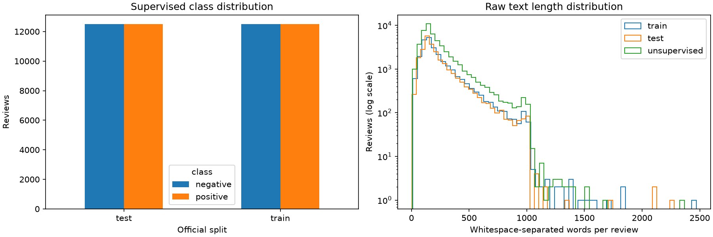

# IMDB: loading and initial analysis

## Task and source

Predict binary sentiment in English movie reviews from the `text` column: `label=0` means negative and `label=1` means positive. There is no neutral target class. The source also includes an unsupervised split whose `label=-1` means unlabeled; it is excluded from supervised classification.

Source: [Hugging Face stanfordnlp/imdb](https://huggingface.co/datasets/stanfordnlp/imdb). Pinned dataset revision: `e6281661ce1c48d982bc483cf8a173c1bbeb5d31`. Official split boundaries and raw texts are preserved.

## Structure and validation

| split | rows | columns | text_dtype | label_dtype | missing_text | missing_label | blank_text | invalid_labels | duplicate_texts_beyond_first | conflicting_label_texts | texts_with_html_breaks |
| --- | --- | --- | --- | --- | --- | --- | --- | --- | --- | --- | --- |
| train | 25000 | 2 | str | int64 | 0 | 0 | 0 | 0 | 96 | 0 | 14665 |
| test | 25000 | 2 | str | int64 | 0 | 0 | 0 | 0 | 199 | 0 | 14535 |
| unsupervised | 50000 | 2 | str | int64 | 0 | 0 | 0 | 0 | 493 | 0 | 29608 |

Total loaded rows: 100,000; supervised rows: 50,000. Required columns are `text` and `label`. The loader checks nonempty frames, required columns, missing values, string and nonblank texts, integer labels, and allowed label values before returning data. Duplicate counts are exact raw text duplicates beyond the first occurrence; conflicting-label counts refer to distinct raw texts.

## Class distribution

| split | label | class | count | percent |
| --- | --- | --- | --- | --- |
| train | 0 | negative | 12500 | 50.00 |
| train | 1 | positive | 12500 | 50.00 |
| test | 0 | negative | 12500 | 50.00 |
| test | 1 | positive | 12500 | 50.00 |
| unsupervised | -1 | unlabeled | 50000 | 100.00 |

Percentages use the row count of each split as denominator. The unlabeled rows are not a third class.

## Text lengths

Lengths are measured on raw text before cleaning: characters use Python string length (including spaces and markup); words use whitespace splitting (`str.split()`), not linguistic tokenization. Attached HTML tags may therefore count as part of a word. Standard deviation is the sample standard deviation. Percentile columns describe the full split.

| split | unit | count | mean | std | min | 25% | 50% | 75% | 90% | 95% | 99% | max |
| --- | --- | --- | --- | --- | --- | --- | --- | --- | --- | --- | --- | --- |
| train | characters | 25000.00 | 1325.07 | 1003.13 | 52.00 | 702.00 | 979.00 | 1614.00 | 2617.00 | 3432.05 | 5213.01 | 13704.00 |
| train | whitespace_words | 25000.00 | 233.79 | 173.73 | 10.00 | 127.00 | 174.00 | 284.00 | 458.00 | 598.00 | 913.00 | 2470.00 |
| test | characters | 25000.00 | 1293.79 | 975.91 | 32.00 | 696.00 | 962.00 | 1572.00 | 2544.10 | 3333.00 | 5138.09 | 12988.00 |
| test | whitespace_words | 25000.00 | 228.53 | 168.88 | 4.00 | 126.00 | 172.00 | 277.00 | 444.00 | 582.05 | 901.00 | 2278.00 |
| unsupervised | characters | 50000.00 | 1329.90 | 1004.67 | 43.00 | 703.00 | 983.00 | 1619.00 | 2612.00 | 3469.00 | 5300.03 | 14282.00 |
| unsupervised | whitespace_words | 50000.00 | 234.43 | 173.77 | 9.00 | 127.00 | 175.00 | 285.00 | 455.00 | 604.00 | 928.01 | 2367.00 |

## Labeled examples

Two training reviews per class sampled with `random_state=42`. Excerpts below are limited to 450 characters, with HTML escaped for display. Full original examples are in `examples.csv`. These illustrate the labels, rather than establishing how typical every review is.

### Train row 1766 — negative (0)

> Wow, what a total let down! The fact people think this film is scary is ridiculous. The special effects were a direct rip-off of &quot;The ring.&quot; The story? Was there one? Not in my opinion..Just a bunch of flashy imaging. The entire film was a boring, stupid, mess. I guess there is always a market for bad films with good marketing campaigns. However, this is the worst horror film I have seen in years. And that Buffy chick? Well, she&#x27;s a bad actress! …

### Train row 11919 — negative (0)

> If Bob Ludlum was to see this mini series, he would have cried. This was complete waste of time and money. I have read the book and even though movies are not exactly what the book may be, CBS wasted time and money on this and it is embarrassing to claim that this was Ludlum&#x27;s work.&lt;br /&gt;&lt;br /&gt;May be the creator should check out the Bourne Identity with Richard Chamberlain and see how good that TV series was.&lt;br /&gt;&lt;br /&gt;Poor Mira, Blair, Anjelica…

### Train row 14266 — positive (1)

> This movie is to Halloween what the hilarious &quot;Christmas Story&quot; is to Christmas: both are relatively low-budget, no-big-name-stars type films...and both are two of the absolute greatest and funniest movies available, both seasonal CLASSICS!!! &quot;Spaced Invaders&quot; comes galloping out right from the start with warmth and humor and a superb cast of characters...all five goofy Martians, Klembecker the Realtor, Russell the deputy, Vern at the &quot;fuel dispe…

### Train row 24419 — positive (1)

> Good western filmed in the rocky Arizona wilds. Lots of tough guys throughout; Cobern&#x27;s character seemed to rock back and forth between a raging psycho and a laid back type. Several holes appeared in the picture, but not enough to offset it being exciting and worth seeing. One really dumb scene shows Heston emptying .45 cases of their powder and collecting it in a sack for the purpose of starting a fire. A. To gather that much gunpowder he would …

## Initial observations and later-stage implications

- Both supervised splits are exactly balanced across positive and negative reviews (see counts above). Class balance alone does not establish model quality.
- Validation passed for every split: no missing or blank texts and no invalid labels were found. This is a structural check, not a manual audit of sentiment annotation accuracy.
- HTML break markup occurs in 58,808 reviews. Later preprocessing should handle markup consistently; this stage preserves it.
- Lengths are right-skewed: the upper percentiles and maxima exceed the median substantially. Review length and unusually long inputs will matter when selecting text features.
- There are 788 within-split duplicate rows beyond the first, 0 within-split distinct texts with conflicting labels, and 123 distinct exact texts shared by train and test. These counts use unnormalized strings; near-duplicates are not detected. Review overlap and label conflicts before modeling; do not silently alter the official benchmark.
- Movie-review sentiment is the scope of this dataset. Results on it would not establish performance on neutral reviews, other domains, or other languages.
- Keep the official test split for final evaluation. In later stages, create a reproducible validation split from training data and fit learned transformations on training data only. No model, learned transformation, or text cleaning was fitted in this stage.
